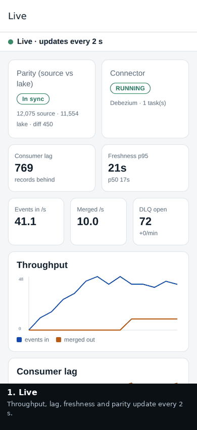

# On-Call Console: what was built, how to run it, what is left

Branch `feat/oncall-console`. Nothing was pushed. Phase 6 (real GitHub, real phone, real push) is yours: section 5.
Numbers in sections 2 and 4 are written by scripts from `results/oncall/*.json` (never typed): `python oncall/tools/readme_numbers.py --done`.

---

## 1. How to run everything, and which ports to tunnel

The console's own services (API, metrics, replay-svc, mock GitHub, web server, SeaweedFS) listen on **127.0.0.1 only**. The repo's original compose services (Postgres, Kafka, Schema Registry, Connect, Prometheus, Pushgateway, Grafana) were published on all interfaces; the compose file now prefixes them with `127.0.0.1:` too, but containers already running keep their old mapping until re-created (re-creating the object store without its new volume would wipe the lake), so also keep this box's security group closed and note Spark's UI on 4040 is not loopback-bound. From your laptop, tunnel the ports you need:

```bash
ssh -N -L 127.0.0.1:8088:127.0.0.1:8088 \
       -L 127.0.0.1:19006:127.0.0.1:19006 \
       -L 127.0.0.1:3000:127.0.0.1:3000 ubuntu@<this-box>
```

| Port | What | When you need it |
|---|---|---|
| **8088** | `oncall-api`: REST, WebSocket `/v1/live`, OAuth `/v1/auth/*` | always, for the app |
| **19006** | Expo **web** build (served by `node oncall/mobile/scripts/serve-web.mjs oncall/mobile/dist`, and by `make oncall-e2e`) | to try the app in a browser (8081 is the Schema Registry, so the web build is on 19006) |
| 8099 | mock GitHub (demo sign-in) | only for the mock-OAuth demo |
| 8089 | Prometheus metrics of the API (loopback only, not the public router) | optional |
| 3000 / 9090 / 9091 | Grafana / Prometheus / Pushgateway (the repo's own) | optional |
| 50051 | replay-svc (gRPC) | no (internal) |

Commands (from the repo root, on the box):

```bash
make env                 # once: writes a git-ignored .env with random local dev values (never prints it)
make oncall-up           # docker compose (Postgres, Kafka, Schema Registry, Connect+Debezium, SeaweedFS, Prometheus, Grafana),
                         # topics, connector, Delta table, the Spark job, replay-svc, mock GitHub, the Go API
make oncall-status       # what is running
make oncall-e2e          # Playwright on the Expo web build against the live stack (mock GitHub): screenshots + results/oncall/e2e.json
make ws-load             # k6: 1,000 WebSocket clients, then the slow-client variant -> results/oncall/ws_load.json
make bullets             # resume bullets with numbers from the results files (MISSING for absent keys)
make results             # re-run the suites that do not need the full stack and rewrite tests.json / schema_gate.json
make oncall-down         # stop the processes (ARGS=--all also stops the containers)
```

Try the app yourself with the mock GitHub (laptop browser, tunnel above): open `http://127.0.0.1:19006`, press *Sign in with GitHub*, choose **admin-user** (admin) or **viewer-user**.
Start some load from the admin API: `TOK=$(oncall/bin/oncall-api token -sub admin-user -role admin)` (reads `.env` itself, prints only the token) then
`curl -X POST 127.0.0.1:8088/v1/generator -H "Authorization: Bearer $TOK" -H 'Idempotency-Key: demo-0001' -H 'Content-Type: application/json' -d '{"action":"start","rate":40}'`.
Inject the demo bad record: `venv/bin/python oncall/tools/dlq_demo.py inject MERCH_DEMO_X`, fix it with `... fix MERCH_DEMO_X`, then wait about two minutes (the pipeline refreshes its merchant cache every 120 s) before replaying.

Versions and the CI/CD files: `docs/oncall/VERSIONS.md`, `.github/workflows/oncall-ci.yml`.

---

## 2. Test results and every results value (generated)

<!-- results:start -->
### Numbers table

| Measure | Value | Source |
|---|---|---|
| Rows matched after a driver kill (parity checker rerun, this box) | 2,924 of 2,924 | `results/oncall/audit_driver_kill.json` |
| Existing pipeline pytest tests | 23 | `results/oncall/tests.json` |
| Skew, max-to-min task records (committed Spark UI screenshots) | 16.4x to 3.0x (82% cut) | `results/oncall/audit_summary.json` |
| Skew rerun on a smaller dataset (salted aggregation) | 7.9x to 2.2x (72% cut) | `results/oncall/audit_summary.json` |
| Same DLQ record replayed twice | APPLIED then ALREADY_APPLIED | `results/oncall/replay_test.json` |
| Lake rows for that key (after both replays and a direct duplicate publish to Kafka) | 1 | `results/oncall/replay_test.json` |
| Audit rows for the two replays | 2 | `results/oncall/replay_test.json` |
| WebSocket clients established / failed (k6, local, 1,000 target) | 1,000 / 0 | `results/oncall/ws_load.json` |
| Snapshots received / expected for the time each client was connected (median, min) | 1.00 / 1.00 (median client received 166) | `results/oncall/ws_load.json` |
| Delivery latency p50 / p95 / p99 (ms) | 24.0 / 48.0 / 73.0 | `results/oncall/ws_load.json` |
| Unexpected disconnects / out-of-order frames | 0 / 0 | `results/oncall/ws_load.json` |
| Server peak RSS (MB) / average CPU cores during the hold | 112.0 / 0.05 | `results/oncall/ws_load.json` |
| Slow-client run: slow readers closed by the server | 100 | `results/oncall/ws_load.json` |
| Slow-client run: fast clients' delivery p95 / p99 (ms) vs baseline | 44.0 / 78.0 vs 48.0 / 73.0 | `results/oncall/ws_load.json` |
| Avro gate: breaking fixtures rejected / compatible accepted | 3 of 3 / 3 of 3 | `results/oncall/schema_gate.json` |
| New pytest tests (replay-svc, progress events, schema gate) | 46 | `results/oncall/tests.json` |
| Go tests under the race detector | 121 | `results/oncall/tests.json` |
| Jest tests | 60 | `results/oncall/tests.json` |
| Playwright end-to-end tests (Expo web build, mock GitHub) | 7 of 7 | `results/oncall/e2e.json` |
| Screenshots captured | 17 | `results/oncall/e2e.json` |

Load test label: local load test: clients and server on the same box (loopback), not a production measurement. Instance type: t3.2xlarge (8 vCPUs). Generated by `oncall/tools/readme_numbers.py`.

### Every results value

<details><summary><code>results/oncall/after_final_pipeline_check.json</code> (15 values)</summary>

- `commit` = 320ed1e
- `dirty` = true
- `generated_at_utc` = 2026-11-16T08:41:51Z
- `command` = python oncall/tools/collect_baseline.py --out after_final_pipeline_check.json
- `stack` = existing pipeline, SeaweedFS in place of MinIO (re-run after a pipeline-side change)
- `checks.pytest.command` = python -m pytest spark/tests/ -v
- `checks.pytest.exit_code` = 0
- `checks.pytest.seconds` = 23.1
- `checks.pytest.passed` = 23
- `checks.parity_checker.command` = python scripts/parity_checker.py
- `checks.parity_checker.exit_code` = 0
- `checks.parity_checker.seconds` = 27.8
- `checks.replay_offsets_both.command` = python scripts/chaos/replay_offsets.py --mode both
- `checks.replay_offsets_both.exit_code` = 0
- `checks.replay_offsets_both.seconds` = 48.3

</details>

<details><summary><code>results/oncall/after_final_pipeline_check_run1_heals_quarantined_rows.json</code> (15 values)</summary>

- `commit` = 320ed1e
- `dirty` = true
- `generated_at_utc` = 2026-11-16T08:39:56Z
- `command` = python oncall/tools/collect_baseline.py --out after_final_pipeline_check.json
- `stack` = existing pipeline, SeaweedFS in place of MinIO (re-run after a pipeline-side change)
- `checks.pytest.command` = python -m pytest spark/tests/ -v
- `checks.pytest.exit_code` = 0
- `checks.pytest.seconds` = 21.4
- `checks.pytest.passed` = 23
- `checks.parity_checker.command` = python scripts/parity_checker.py
- `checks.parity_checker.exit_code` = 1
- `checks.parity_checker.seconds` = 28.0
- `checks.replay_offsets_both.command` = python scripts/chaos/replay_offsets.py --mode both
- `checks.replay_offsets_both.exit_code` = 1
- `checks.replay_offsets_both.seconds` = 46.0

</details>

<details><summary><code>results/oncall/after_phase1_progress_events.json</code> (15 values)</summary>

- `commit` = 5f1f065
- `dirty` = true
- `generated_at_utc` = 2026-11-16T06:34:58Z
- `command` = python oncall/tools/collect_baseline.py --out after_phase1_progress_events.json
- `stack` = existing pipeline, SeaweedFS in place of MinIO (re-run after a pipeline-side change)
- `checks.pytest.command` = python -m pytest spark/tests/ -v
- `checks.pytest.exit_code` = 0
- `checks.pytest.seconds` = 22.3
- `checks.pytest.passed` = 23
- `checks.parity_checker.command` = python scripts/parity_checker.py
- `checks.parity_checker.exit_code` = 0
- `checks.parity_checker.seconds` = 27.0
- `checks.replay_offsets_both.command` = python scripts/chaos/replay_offsets.py --mode both
- `checks.replay_offsets_both.exit_code` = 0
- `checks.replay_offsets_both.seconds` = 44.6

</details>

<details><summary><code>results/oncall/after_phase2_progress_offsets.json</code> (15 values)</summary>

- `commit` = 49c0161
- `dirty` = true
- `generated_at_utc` = 2026-11-16T07:05:32Z
- `command` = python oncall/tools/collect_baseline.py --out after_phase2_progress_offsets.json
- `stack` = existing pipeline, SeaweedFS in place of MinIO (re-run after a pipeline-side change)
- `checks.pytest.command` = python -m pytest spark/tests/ -v
- `checks.pytest.exit_code` = 0
- `checks.pytest.seconds` = 21.5
- `checks.pytest.passed` = 23
- `checks.parity_checker.command` = python scripts/parity_checker.py
- `checks.parity_checker.exit_code` = 0
- `checks.parity_checker.seconds` = 26.3
- `checks.replay_offsets_both.command` = python scripts/chaos/replay_offsets.py --mode both
- `checks.replay_offsets_both.exit_code` = 0
- `checks.replay_offsets_both.seconds` = 46.7

</details>

<details><summary><code>results/oncall/audit_driver_kill.json</code> (16 values)</summary>

- `commit` = 76edd81
- `dirty` = true
- `generated_at_utc` = 2026-11-16T06:05:23Z
- `command` = python oncall/tools/audit_driver_kill.py
- `resumed_from_checkpoint` = true
- `parity_exit_code` = 0
- `parity_pass` = true
- `parity.Postgres rows` = 2924
- `parity.Delta live rows` = 2924
- `parity.missing_in_delta_total` = 0
- `parity.unaccounted (not in DLQ either)` = 0
- `parity.quarantined` = 0
- `parity.extra_in_delta` = 0
- `parity.value_mismatch` = 0
- `parity.duplicate_keys_in_delta` = 0
- `job_pid_now` = 37805

</details>

<details><summary><code>results/oncall/audit_skew.json</code> (21 values)</summary>

- `commit` = 76edd81
- `dirty` = true
- `generated_at_utc` = 2026-11-16T06:21:08Z
- `command` = python oncall/tools/audit_skew.py
- `naive.stage_id` = 8
- `naive.tasks` = 8
- `naive.total_records` = 6039
- `naive.min` = 229.0
- `naive.median` = 752.0
- `naive.max` = 1800.0
- `naive.max_over_min` = 7.86
- `naive.max_over_median` = 2.39
- `salted.stage_id` = 16
- `salted.tasks` = 8
- `salted.total_records` = 6039
- `salted.min` = 503.0
- `salted.median` = 796.0
- `salted.max` = 1098.0
- `salted.max_over_min` = 2.18
- `salted.max_over_median` = 1.38
- `reduction_pct` = 72.3

</details>

<details><summary><code>results/oncall/audit_summary.json</code> (99 values)</summary>

- `commit` = 48b17c0
- `dirty` = true
- `generated_at_utc` = 2026-11-16T08:55:21Z
- `command` = python oncall/tools/audit.py
- `rows[0].num` = 1
- `rows[0].claim` = The stack runs: Postgres, Debezium, Kafka, Schema Registry, Spark job, Delta on S3-compatible storage
- `rows[0].exists` = yes
- `rows[0].runs` = yes (after the MinIO image replacement, DECISIONS D-001)
- `rows[0].tested` = parity checker + chaos scripts
- `rows[0].verdict` = TRUE
- `rows[0].action` = none
- `rows[1].num` = 2
- `rows[1].claim` = "100,812 of 100,812 rows matched after a driver kill"
- `rows[1].exists` = partly
- `rows[1].runs` = yes (rerun below)
- `rows[1].tested` = oncall/tools/audit_driver_kill.py (repo scripts: data_generator, kill_spark.sh, restart, parity_checker)
- `rows[1].verdict` = NOT VERIFIABLE AS WRITTEN (mechanism verified)
- `rows[1].action` = Reword. 100,812 is README text with no committed parity output behind it (the largest committed parity screenshot is 52,361). Use the measured rerun: "matched 2,924 of 2,924 rows after a driver kill and checkpoint restart".
- `rows[2].num` = 3
- `rows[2].claim` = Idempotent Delta MERGE with an LSN watermark and a batch ledger
- `rows[2].exists` = yes
- `rows[2].runs` = yes
- `rows[2].tested` = scripts/chaos/replay_offsets.py --mode both
- `rows[2].verdict` = TRUE
- `rows[2].action` = none
- `rows[3].num` = 4
- `rows[3].claim` = Validator and DLQ
- `rows[3].exists` = yes
- `rows[3].runs` = yes
- `rows[3].tested` = scripts/inject_bad_records.py (5 tests) and spark/tests/test_validator.py
- `rows[3].verdict` = TRUE
- `rows[3].action` = none. Facts for the console: DLQ lives in Kafka topic payments.transactions.dlq (JSON), is append-only (at-least-once), and the currency rule is a hard-coded set while the merchant rule reads Postgres `merchants` (cached 120 s). The demo scenario therefore uses an unknown merchant.
- `rows[4].num` = 5
- `rows[4].claim` = "23 pytest tests"
- `rows[4].exists` = yes
- `rows[4].runs` = yes
- `rows[4].tested` = python -m pytest spark/tests/ -v
- `rows[4].verdict` = TRUE (23 passed)
- `rows[4].action` = none
- `rows[5].num` = 6
- `rows[5].claim` = CI schema check
- `rows[5].exists` = only on old PR branches (not in this tree)
- `rows[5].runs` = partly
- `rows[5].tested` = none in this tree
- `rows[5].verdict` = PARTLY TRUE
- `rows[5].action` = No resume change needed for existing lines, but the gate must be rebuilt: it is a real registry compatibility call (not shape-only), yet it is skipped when no proposed file exists, the committed baseline is empty, and no workflow is checked in. Phase 5 builds it.
- `rows[6].num` = 7
- `rows[6].claim` = "data skew cut 82% (16.4x to 3.0x) with salted aggregation"
- `rows[6].exists` = yes
- `rows[6].runs` = yes
- `rows[6].tested` = oncall/tools/audit_skew.py (reruns the repo job and reads Spark REST task stats)
- `rows[6].verdict` = PARTLY TRUE (mechanism and direction reproduced; the rerun on smaller data gave a smaller cut, so 82% rests on the screenshots)
- `rows[6].action` = Keep, but name the metric: the ratio is max-to-min records per task in the final stage, mechanism is two-phase salted aggregation on (merchant_id, salt) in the aggregation consumer only. The rerun on a smaller dataset gave 7.86x to 2.18x (72.3%), so the 82% figure rests on the committed screenshots.
- `rows[7].num` = 8
- `rows[7].claim` = Avro in the path (Schema Registry, schema-id decode)
- `rows[7].exists` = yes
- `rows[7].runs` = yes
- `rows[7].tested` = inject_bad_records.py publishes Avro; whole stack decodes it
- `rows[7].verdict` = TRUE (README's BACKWARD_TRANSITIVE is not reproduced)
- `rows[7].action` = Do not say BACKWARD_TRANSITIVE anywhere: the live subject uses the registry default, BACKWARD, and nothing in the repo configures TRANSITIVE. Avro and Schema Registry claims are true.
- `rows[8].num` = 9
- `rows[8].claim` = Prometheus and Grafana
- `rows[8].exists` = yes
- `rows[8].runs` = yes
- `rows[8].tested` = live queries
- `rows[8].verdict` = TRUE
- `rows[8].action` = none. Note Prometheus only scrapes the Pushgateway; the Go console reads Kafka/Connect/Postgres/lake directly.
- `rows[9].num` = 10
- `rows[9].claim` = Runbooks and incident write-up
- `rows[9].exists` = runbooks: no. SLA write-up: yes
- `rows[9].runs` = n/a
- `rows[9].tested` = n/a
- `rows[9].verdict` = PARTLY TRUE
- `rows[9].action` = Do not claim runbooks on a resume: the four files the README names are not in the repo. The inconsistency-window write-up exists.
- `resume_changes[0].as_written` = matched 100,812 of 100,812 rows after a driver kill
- `resume_changes[0].problem` = 100,812 is README text with no committed parity output; the largest committed parity screenshot is 52,361
- `resume_changes[0].new_wording` = matched 2,924 of 2,924 rows after a driver kill and checkpoint restart (parity checker rerun, 0 missing / 0 extra / 0 mismatched)
- `resume_changes[1].as_written` = data skew cut 82% (16.4x to 3.0x)
- `resume_changes[1].problem` = metric undefined; reproduced only in direction on smaller data
- `resume_changes[1].new_wording` = data skew cut 82% (16.4x to 3.0x max-to-min task records) with two-phase salted aggregation (rerun on a smaller set: 7.86x to 2.18x)
- `resume_changes[2].as_written` = BACKWARD_TRANSITIVE (README only)
- `resume_changes[2].problem` = the registry subject is BACKWARD
- `resume_changes[2].new_wording` = Avro contracts in Schema Registry (BACKWARD compatibility)
- `resume_changes[3].as_written` = runbooks (README only)
- `resume_changes[3].problem` = runbook files are not in the repo
- `resume_changes[3].new_wording` = (drop the word, or add the files)
- `numbers.driver_kill_rows_postgres` = 2924
- `numbers.driver_kill_rows_delta` = 2924
- `numbers.pytest_passed` = 23
- `numbers.skew_rerun_naive_max_over_min` = 7.86
- `numbers.skew_rerun_salted_max_over_min` = 2.18
- `numbers.skew_rerun_reduction_pct` = 72.3
- `numbers.skew_screenshot_naive_min` = 346
- `numbers.skew_screenshot_naive_max` = 5667
- `numbers.skew_screenshot_salted_min` = 935
- `numbers.skew_screenshot_salted_max` = 2776
- `numbers.skew_screenshot_naive_ratio` = 16.378612716763005
- `numbers.skew_screenshot_salted_ratio` = 2.968983957219251
- `numbers.skew_screenshot_reduction_pct` = 81.87279955535803

</details>

<details><summary><code>results/oncall/baseline.json</code> (15 values)</summary>

- `commit` = 76edd81
- `dirty` = true
- `generated_at_utc` = 2026-11-16T05:44:33Z
- `command` = python oncall/tools/collect_baseline.py
- `stack` = existing pipeline, SeaweedFS in place of MinIO
- `checks.pytest.command` = python -m pytest spark/tests/ -v
- `checks.pytest.exit_code` = 0
- `checks.pytest.seconds` = 20.6
- `checks.pytest.passed` = 23
- `checks.parity_checker.command` = python scripts/parity_checker.py
- `checks.parity_checker.exit_code` = 0
- `checks.parity_checker.seconds` = 23.3
- `checks.replay_offsets_both.command` = python scripts/chaos/replay_offsets.py --mode both
- `checks.replay_offsets_both.exit_code` = 0
- `checks.replay_offsets_both.seconds` = 42.4

</details>

<details><summary><code>results/oncall/e2e.json</code> (30 values)</summary>

- `commit` = 320ed1e
- `dirty` = true
- `generated_at_utc` = 2026-11-16T08:38:06Z
- `command` = make oncall-e2e
- `tests` = 7
- `passed` = 7
- `failed` = 0
- `screenshots[0]` = 01-login.png
- `screenshots[1]` = 02-mock-github.png
- `screenshots[2]` = 03-live.png
- `screenshots[3]` = 04-alerts-firing.png
- `screenshots[4]` = 05-alerts-acknowledged.png
- `screenshots[5]` = 06-dlq-list.png
- `screenshots[6]` = 07-dlq-detail.png
- `screenshots[7]` = 08-viewer-no-replay.png
- `screenshots[8]` = 09-replay-confirm.png
- `screenshots[9]` = 10-replay-applied.png
- `screenshots[10]` = 11-dlq-after-replay.png
- `screenshots[11]` = 12-audit.png
- `screenshots[12]` = 13-replay-already-applied.png
- `screenshots[13]` = 14-alerts-after.png
- `screenshots[14]` = 15-settings.png
- `screenshots[15]` = 16-not-allowed.png
- `screenshots[16]` = 17-live-in-sync.png
- `stats.startTime` = 2026-11-16T08:34:21.890Z
- `stats.duration` = 224408.912
- `stats.expected` = 7
- `stats.skipped` = 0
- `stats.unexpected` = 0
- `stats.flaky` = 0

</details>

<details><summary><code>results/oncall/proto_gate.json</code> (14 values)</summary>

- `commit` = 320ed1e
- `dirty` = true
- `generated_at_utc` = 2026-11-16T08:42:48Z
- `command` = python oncall/tools/proto_gate.py
- `buf_version` = 1.75.0
- `lint.exit_code` = 0
- `lint.output` = clean
- `breaking_against_first_proto_commit.against_commit` = 49c0161
- `breaking_against_first_proto_commit.exit_code` = 0
- `breaking_against_first_proto_commit.output` = no breaking changes
- `breaking_against_deliberately_broken_copy.exit_code` = 100
- `breaking_against_deliberately_broken_copy.detected` = true
- `breaking_against_deliberately_broken_copy.output` = ["/tmp/proto-gate-w1xf6tpe/p/oncall/v1/replay.proto:36:1:Previously present field \"2\" with name \"requested_by\" on message \"ReplayRequest\" was deleted.", "/tmp/proto-gate-w1xf6tpe/p/oncall/v1/replay.proto:37:3:Field \"1\" with name \"dlq_id\" on message \"ReplayRequest\" changed type from \"string\" to \"int32\"."]
- `passed` = true

</details>

<details><summary><code>results/oncall/replay_test.json</code> (16 values)</summary>

- `commit` = 49c0161
- `dirty` = true
- `generated_at_utc` = 2026-11-16T07:02:39Z
- `command` = python oncall/tools/replay_test.py
- `passed` = true
- `transaction_id` = 3001de0d-ba27-4f2e-9db9-d0065e9071b0
- `dlq_id` = 110
- `first_replay_status` = APPLIED
- `second_replay_status` = ALREADY_APPLIED
- `repeat_same_key_returned_first_result` = true
- `lake_rows_for_key_after_replays` = 1
- `lake_rows_for_key_after_duplicate_publish` = 1
- `lake_lsn` = 38799424
- `record_lsn` = 38799424
- `audit_rows_for_the_two_replays` = 2
- `audit_rows_for_target_total` = 3

</details>

<details><summary><code>results/oncall/schema_gate.json</code> (47 values)</summary>

- `commit` = 320ed1e
- `dirty` = true
- `generated_at_utc` = 2026-11-16T08:42:39Z
- `command` = python scripts/check_schema_compat.py --self-test --json results/oncall/schema_gate.json
- `compatibility_level` = BACKWARD
- `engines` = ["local (apache avro)", "schema registry /compatibility"]
- `breaking_fixtures_rejected` = 3
- `breaking_fixtures_total` = 3
- `compatible_fixtures_accepted` = 3
- `compatible_fixtures_total` = 3
- `all_as_expected` = true
- `fixtures[0].fixture` = transactions_v2.avsc
- `fixtures[0].expect` = compatible
- `fixtures[0].why` = the baseline against itself
- `fixtures[0].local_verdict` = compatible
- `fixtures[0].registry_verdict` = compatible
- `fixtures[0].passed` = true
- `fixtures[1].fixture` = compatible_add_optional_field.avsc
- `fixtures[1].expect` = compatible
- `fixtures[1].why` = a new nullable field WITH a default (what PR #4 added: `channel`). Old messages simply lack it and the reader fills the default.
- `fixtures[1].local_verdict` = compatible
- `fixtures[1].registry_verdict` = compatible
- `fixtures[1].passed` = true
- `fixtures[2].fixture` = compatible_remove_field.avsc
- `fixtures[2].expect` = compatible
- `fixtures[2].why` = a removed field is NOT breaking under BACKWARD (the reader ignores the extra data in old messages); it would be breaking under FORWARD.
- `fixtures[2].local_verdict` = compatible
- `fixtures[2].registry_verdict` = compatible
- `fixtures[2].passed` = true
- `fixtures[3].fixture` = breaking_rename_field.avsc
- `fixtures[3].expect` = breaking
- `fixtures[3].why` = `currency` renamed to `ccy` (PR #5, the red run): a new field without a default that old messages do not have.
- `fixtures[3].local_verdict` = breaking
- `fixtures[3].registry_verdict` = breaking
- `fixtures[3].passed` = true
- `fixtures[4].fixture` = breaking_type_change.avsc
- `fixtures[4].expect` = breaking
- `fixtures[4].why` = `amount_minor` changed from long to string: old long values cannot be read as string.
- `fixtures[4].local_verdict` = breaking
- `fixtures[4].registry_verdict` = breaking
- `fixtures[4].passed` = true
- `fixtures[5].fixture` = breaking_add_required_field.avsc
- `fixtures[5].expect` = breaking
- `fixtures[5].why` = a new field WITHOUT a default: old messages have no value for it.
- `fixtures[5].local_verdict` = breaking
- `fixtures[5].registry_verdict` = breaking
- `fixtures[5].passed` = true

</details>

<details><summary><code>results/oncall/tests.json</code> (41 values)</summary>

- `commit` = 320ed1e
- `dirty` = true
- `generated_at_utc` = 2026-11-16T08:42:34Z
- `command` = python oncall/tools/make_tests_json.py
- `suites.pytest_existing_pipeline.command` = python -m pytest spark/tests
- `suites.pytest_existing_pipeline.tests` = 23
- `suites.pytest_existing_pipeline.passed` = 23
- `suites.pytest_existing_pipeline.failed` = 0
- `suites.pytest_existing_pipeline.skipped` = 0
- `suites.pytest_existing_pipeline.exit_code` = 0
- `suites.pytest_new_oncall.command` = python -m pytest oncall/replay/tests
- `suites.pytest_new_oncall.tests` = 46
- `suites.pytest_new_oncall.passed` = 46
- `suites.pytest_new_oncall.failed` = 0
- `suites.pytest_new_oncall.skipped` = 0
- `suites.pytest_new_oncall.exit_code` = 0
- `suites.go_race.command` = cd oncall/api && go test -race -count=1 ./...
- `suites.go_race.tests` = 121
- `suites.go_race.passed` = 121
- `suites.go_race.failed` = 0
- `suites.go_race.skipped` = 0
- `suites.go_race.packages` = 11
- `suites.go_race.packages_failed` = 0
- `suites.go_race.exit_code` = 0
- `suites.go_race.race_detector` = true
- `suites.go_race.postgres_integration` = true
- `suites.jest.command` = cd oncall/mobile && npx jest --ci
- `suites.jest.tests` = 60
- `suites.jest.passed` = 60
- `suites.jest.failed` = 0
- `suites.jest.skipped` = 0
- `suites.jest.suites` = 6
- `suites.jest.exit_code` = 0
- `suites.playwright.command` = make oncall-e2e (Playwright on the Expo web build)
- `suites.playwright.tests` = 7
- `suites.playwright.passed` = 7
- `suites.playwright.failed` = 0
- `suites.playwright.from_commit` = 320ed1e
- `suites.playwright.generated_at_utc` = 2026-11-16T08:38:06Z
- `total_tests` = 257
- `total_failed` = 0

</details>

<details><summary><code>results/oncall/ws_load.json</code> (237 values)</summary>

- `commit` = 320ed1e
- `dirty` = true
- `generated_at_utc` = 2026-11-16T08:33:49Z
- `command` = make ws-load
- `label` = local load test: clients and server on the same box (loopback), not a production measurement
- `instance_type` = t3.2xlarge
- `vcpus` = 8
- `scope_not_measured.push_interval_seconds` = 2
- `scope_not_measured.target_clients` = 1000
- `variants.baseline.k6.variant` = baseline
- `variants.baseline.k6.target_clients` = 1000
- `variants.baseline.k6.ramp` = 60s
- `variants.baseline.k6.hold` = 5m
- `variants.baseline.k6.connected` = 1000
- `variants.baseline.k6.connect_failed` = 0
- `variants.baseline.k6.unexpected_close` = 0
- `variants.baseline.k6.snapshots_received` = 165905
- `variants.baseline.k6.alerts_received` = 0
- `variants.baseline.k6.seq_violations` = 0
- `variants.baseline.k6.delivery_ms.count` = 164905
- `variants.baseline.k6.delivery_ms.min` = 1
- `variants.baseline.k6.delivery_ms.p50` = 24
- `variants.baseline.k6.delivery_ms.p90` = 41
- `variants.baseline.k6.delivery_ms.p95` = 48
- `variants.baseline.k6.delivery_ms.p99` = 73
- `variants.baseline.k6.delivery_ms.max` = 110
- `variants.baseline.k6.snapshots_per_client.min` = 151
- `variants.baseline.k6.snapshots_per_client.p50` = 166
- `variants.baseline.k6.snapshots_per_client.max` = 181
- `variants.baseline.k6.snapshots_per_client.clients` = 1000
- `variants.baseline.k6.received_over_expected.min` = 1
- `variants.baseline.k6.received_over_expected.p50` = 1
- `variants.baseline.k6.received_over_expected.p90` = 1.0063291139240507
- `variants.baseline.k6.received_over_expected.max` = 1.0066225165562914
- `variants.baseline.k6.expected_snapshots_per_client_if_connected_for_ramp_plus_hold` = 181
- `variants.baseline.k6.iterations` = 1000
- `variants.baseline.server.avg_cpu_cores_during_hold` = 0.053
- `variants.baseline.server.peak_rss_mb` = 112.0
- `variants.baseline.server.peak_heap_inuse_mb` = 56.2
- `variants.baseline.server.peak_goroutines` = 3040
- `variants.baseline.server.peak_open_fds` = 1018
- `variants.baseline.server.peak_ws_clients` = 1000
- `variants.baseline.server.ws_clients_dropped_total` = 0
- `variants.baseline.server.ws_write_timeouts_total` = 0
- `variants.baseline.server.ws_ping_timeouts_total` = 0
- `variants.baseline.server.ws_connects_total` = 1000
- `variants.baseline.server.snapshots_published_total` = 180
- `variants.baseline.server.metric_samples` = 72
- `variants.baseline.snapshots_received_per_client_median` = 166
- `variants.baseline.snapshots_expected_per_client_during_hold` = 181
- `variants.baseline.received_over_expected_min` = 1
- `variants.baseline.received_over_expected_median` = 1
- `variants.baseline.connections_established` = 1000
- `variants.baseline.connections_failed` = 0
- `variants.baseline.unexpected_disconnects` = 0
- `variants.baseline.seq_order_violations` = 0
- `variants.baseline.delivery_latency_ms.count` = 164905
- `variants.baseline.delivery_latency_ms.min` = 1
- `variants.baseline.delivery_latency_ms.p50` = 24
- `variants.baseline.delivery_latency_ms.p90` = 41
- `variants.baseline.delivery_latency_ms.p95` = 48
- `variants.baseline.delivery_latency_ms.p99` = 73
- `variants.baseline.delivery_latency_ms.max` = 110
- `variants.slow_clients.k6.variant` = slow_clients
- `variants.slow_clients.k6.target_clients` = 1000
- `variants.slow_clients.k6.ramp` = 60s
- `variants.slow_clients.k6.hold` = 5m
- `variants.slow_clients.k6.connected` = 1000
- `variants.slow_clients.k6.connect_failed` = 0
- `variants.slow_clients.k6.unexpected_close` = 0
- `variants.slow_clients.k6.snapshots_received` = 165841
- `variants.slow_clients.k6.alerts_received` = 0
- `variants.slow_clients.k6.seq_violations` = 0
- `variants.slow_clients.k6.delivery_ms.count` = 164841
- `variants.slow_clients.k6.delivery_ms.min` = 0
- `variants.slow_clients.k6.delivery_ms.p50` = 23
- `variants.slow_clients.k6.delivery_ms.p90` = 39
- `variants.slow_clients.k6.delivery_ms.p95` = 44
- `variants.slow_clients.k6.delivery_ms.p99` = 78
- `variants.slow_clients.k6.delivery_ms.max` = 129
- `variants.slow_clients.k6.snapshots_per_client.min` = 151
- `variants.slow_clients.k6.snapshots_per_client.p50` = 166
- `variants.slow_clients.k6.snapshots_per_client.max` = 181
- `variants.slow_clients.k6.snapshots_per_client.clients` = 1000
- `variants.slow_clients.k6.received_over_expected.min` = 1
- `variants.slow_clients.k6.received_over_expected.p50` = 1
- `variants.slow_clients.k6.received_over_expected.p90` = 1.00625
- `variants.slow_clients.k6.received_over_expected.max` = 1.0066225165562914
- `variants.slow_clients.k6.expected_snapshots_per_client_if_connected_for_ramp_plus_hold` = 181
- `variants.slow_clients.k6.iterations` = 1000
- `variants.slow_clients.server.avg_cpu_cores_during_hold` = 0.046
- `variants.slow_clients.server.peak_rss_mb` = 111.2
- `variants.slow_clients.server.peak_heap_inuse_mb` = 56.2
- `variants.slow_clients.server.peak_goroutines` = 3040
- `variants.slow_clients.server.peak_open_fds` = 1018
- `variants.slow_clients.server.peak_ws_clients` = 1000
- `variants.slow_clients.server.ws_clients_dropped_total` = 0
- `variants.slow_clients.server.ws_write_timeouts_total` = 0
- `variants.slow_clients.server.ws_ping_timeouts_total` = 103
- `variants.slow_clients.server.ws_connects_total` = 1100
- `variants.slow_clients.server.snapshots_published_total` = 182
- `variants.slow_clients.server.metric_samples` = 73
- `variants.slow_clients.snapshots_received_per_client_median` = 166
- `variants.slow_clients.snapshots_expected_per_client_during_hold` = 181
- `variants.slow_clients.received_over_expected_min` = 1
- `variants.slow_clients.received_over_expected_median` = 1
- `variants.slow_clients.connections_established` = 1000
- `variants.slow_clients.connections_failed` = 0
- `variants.slow_clients.unexpected_disconnects` = 0
- `variants.slow_clients.seq_order_violations` = 0
- `variants.slow_clients.delivery_latency_ms.count` = 164841
- `variants.slow_clients.delivery_latency_ms.min` = 0
- `variants.slow_clients.delivery_latency_ms.p50` = 23
- `variants.slow_clients.delivery_latency_ms.p90` = 39
- `variants.slow_clients.delivery_latency_ms.p95` = 44
- `variants.slow_clients.delivery_latency_ms.p99` = 78
- `variants.slow_clients.delivery_latency_ms.max` = 129
- `variants.slow_clients.slow_clients.close_reasons.failed to read: failed to read frame payload: read tcp 127.0.0.1:59252->127.0.0.1:8088: re` = 1
- `variants.slow_clients.slow_clients.close_reasons.failed to read: failed to read frame payload: read tcp 127.0.0.1:59254->127.0.0.1:8088: re` = 1
- `variants.slow_clients.slow_clients.close_reasons.failed to read: failed to read frame payload: read tcp 127.0.0.1:59280->127.0.0.1:8088: re` = 1
- `variants.slow_clients.slow_clients.close_reasons.failed to read: failed to read frame payload: read tcp 127.0.0.1:59282->127.0.0.1:8088: re` = 1
- `variants.slow_clients.slow_clients.close_reasons.failed to read: failed to read frame payload: read tcp 127.0.0.1:59304->127.0.0.1:8088: re` = 1
- `variants.slow_clients.slow_clients.close_reasons.failed to read: failed to read frame payload: read tcp 127.0.0.1:59316->127.0.0.1:8088: re` = 1
- `variants.slow_clients.slow_clients.close_reasons.failed to read: failed to read frame payload: read tcp 127.0.0.1:59330->127.0.0.1:8088: re` = 1
- `variants.slow_clients.slow_clients.close_reasons.failed to read: failed to read frame payload: read tcp 127.0.0.1:59346->127.0.0.1:8088: re` = 1
- `variants.slow_clients.slow_clients.close_reasons.failed to read: failed to read frame payload: read tcp 127.0.0.1:59350->127.0.0.1:8088: re` = 1
- `variants.slow_clients.slow_clients.close_reasons.failed to read: failed to read frame payload: read tcp 127.0.0.1:59356->127.0.0.1:8088: re` = 1
- `variants.slow_clients.slow_clients.close_reasons.failed to read: failed to read frame payload: read tcp 127.0.0.1:59366->127.0.0.1:8088: re` = 1
- `variants.slow_clients.slow_clients.close_reasons.failed to read: failed to read frame payload: read tcp 127.0.0.1:59382->127.0.0.1:8088: re` = 1
- `variants.slow_clients.slow_clients.close_reasons.failed to read: failed to read frame payload: read tcp 127.0.0.1:59390->127.0.0.1:8088: re` = 1
- `variants.slow_clients.slow_clients.close_reasons.failed to read: failed to read frame payload: read tcp 127.0.0.1:59402->127.0.0.1:8088: re` = 1
- `variants.slow_clients.slow_clients.close_reasons.failed to read: failed to read frame payload: read tcp 127.0.0.1:59408->127.0.0.1:8088: re` = 1
- `variants.slow_clients.slow_clients.close_reasons.failed to read: failed to read frame payload: read tcp 127.0.0.1:59416->127.0.0.1:8088: re` = 1
- `variants.slow_clients.slow_clients.close_reasons.failed to read: failed to read frame payload: read tcp 127.0.0.1:59428->127.0.0.1:8088: re` = 1
- `variants.slow_clients.slow_clients.close_reasons.failed to read: failed to read frame payload: read tcp 127.0.0.1:59434->127.0.0.1:8088: re` = 1
- `variants.slow_clients.slow_clients.close_reasons.failed to read: failed to read frame payload: read tcp 127.0.0.1:59438->127.0.0.1:8088: re` = 1
- `variants.slow_clients.slow_clients.close_reasons.failed to read: failed to read frame payload: read tcp 127.0.0.1:59448->127.0.0.1:8088: re` = 1
- `variants.slow_clients.slow_clients.close_reasons.failed to read: failed to read frame payload: read tcp 127.0.0.1:59460->127.0.0.1:8088: re` = 1
- `variants.slow_clients.slow_clients.close_reasons.failed to read: failed to read frame payload: read tcp 127.0.0.1:59466->127.0.0.1:8088: re` = 1
- `variants.slow_clients.slow_clients.close_reasons.failed to read: failed to read frame payload: read tcp 127.0.0.1:59468->127.0.0.1:8088: re` = 1
- `variants.slow_clients.slow_clients.close_reasons.failed to read: failed to read frame payload: read tcp 127.0.0.1:59480->127.0.0.1:8088: re` = 1
- `variants.slow_clients.slow_clients.close_reasons.failed to read: failed to read frame payload: read tcp 127.0.0.1:59486->127.0.0.1:8088: re` = 1
- `variants.slow_clients.slow_clients.close_reasons.failed to read: failed to read frame payload: read tcp 127.0.0.1:59502->127.0.0.1:8088: re` = 1
- `variants.slow_clients.slow_clients.close_reasons.failed to read: failed to read frame payload: read tcp 127.0.0.1:59510->127.0.0.1:8088: re` = 1
- `variants.slow_clients.slow_clients.close_reasons.failed to read: failed to read frame payload: read tcp 127.0.0.1:59512->127.0.0.1:8088: re` = 1
- `variants.slow_clients.slow_clients.close_reasons.failed to read: failed to read frame payload: read tcp 127.0.0.1:59520->127.0.0.1:8088: re` = 1
- `variants.slow_clients.slow_clients.close_reasons.failed to read: failed to read frame payload: read tcp 127.0.0.1:59532->127.0.0.1:8088: re` = 1
- `variants.slow_clients.slow_clients.close_reasons.failed to read: failed to read frame payload: read tcp 127.0.0.1:59546->127.0.0.1:8088: re` = 1
- `variants.slow_clients.slow_clients.close_reasons.failed to read: failed to read frame payload: read tcp 127.0.0.1:59560->127.0.0.1:8088: re` = 1
- `variants.slow_clients.slow_clients.close_reasons.failed to read: failed to read frame payload: read tcp 127.0.0.1:59576->127.0.0.1:8088: re` = 1
- `variants.slow_clients.slow_clients.close_reasons.failed to read: failed to read frame payload: read tcp 127.0.0.1:59580->127.0.0.1:8088: re` = 1
- `variants.slow_clients.slow_clients.close_reasons.failed to read: failed to read frame payload: read tcp 127.0.0.1:59590->127.0.0.1:8088: re` = 1
- `variants.slow_clients.slow_clients.close_reasons.failed to read: failed to read frame payload: read tcp 127.0.0.1:59600->127.0.0.1:8088: re` = 1
- `variants.slow_clients.slow_clients.close_reasons.failed to read: failed to read frame payload: read tcp 127.0.0.1:59606->127.0.0.1:8088: re` = 1
- `variants.slow_clients.slow_clients.close_reasons.failed to read: failed to read frame payload: read tcp 127.0.0.1:59616->127.0.0.1:8088: re` = 1
- `variants.slow_clients.slow_clients.close_reasons.failed to read: failed to read frame payload: read tcp 127.0.0.1:59622->127.0.0.1:8088: re` = 1
- `variants.slow_clients.slow_clients.close_reasons.failed to read: failed to read frame payload: read tcp 127.0.0.1:59628->127.0.0.1:8088: re` = 1
- `variants.slow_clients.slow_clients.close_reasons.failed to read: failed to read frame payload: read tcp 127.0.0.1:59632->127.0.0.1:8088: re` = 1
- `variants.slow_clients.slow_clients.close_reasons.failed to read: failed to read frame payload: read tcp 127.0.0.1:59640->127.0.0.1:8088: re` = 1
- `variants.slow_clients.slow_clients.close_reasons.failed to read: failed to read frame payload: read tcp 127.0.0.1:59650->127.0.0.1:8088: re` = 1
- `variants.slow_clients.slow_clients.close_reasons.failed to read: failed to read frame payload: read tcp 127.0.0.1:59660->127.0.0.1:8088: re` = 1
- `variants.slow_clients.slow_clients.close_reasons.failed to read: failed to read frame payload: read tcp 127.0.0.1:59676->127.0.0.1:8088: re` = 1
- `variants.slow_clients.slow_clients.close_reasons.failed to read: failed to read frame payload: read tcp 127.0.0.1:59684->127.0.0.1:8088: re` = 1
- `variants.slow_clients.slow_clients.close_reasons.failed to read: failed to read frame payload: read tcp 127.0.0.1:59694->127.0.0.1:8088: re` = 1
- `variants.slow_clients.slow_clients.close_reasons.failed to read: failed to read frame payload: read tcp 127.0.0.1:59698->127.0.0.1:8088: re` = 1
- `variants.slow_clients.slow_clients.close_reasons.failed to read: failed to read frame payload: read tcp 127.0.0.1:59704->127.0.0.1:8088: re` = 1
- `variants.slow_clients.slow_clients.close_reasons.failed to read: failed to read frame payload: read tcp 127.0.0.1:59706->127.0.0.1:8088: re` = 1
- `variants.slow_clients.slow_clients.close_reasons.failed to read: failed to read frame payload: read tcp 127.0.0.1:59720->127.0.0.1:8088: re` = 1
- `variants.slow_clients.slow_clients.close_reasons.failed to read: failed to read frame payload: read tcp 127.0.0.1:59724->127.0.0.1:8088: re` = 1
- `variants.slow_clients.slow_clients.close_reasons.failed to read: failed to read frame payload: read tcp 127.0.0.1:59738->127.0.0.1:8088: re` = 1
- `variants.slow_clients.slow_clients.close_reasons.failed to read: failed to read frame payload: read tcp 127.0.0.1:59744->127.0.0.1:8088: re` = 1
- `variants.slow_clients.slow_clients.close_reasons.failed to read: failed to read frame payload: read tcp 127.0.0.1:59756->127.0.0.1:8088: re` = 1
- `variants.slow_clients.slow_clients.close_reasons.failed to read: failed to read frame payload: read tcp 127.0.0.1:59768->127.0.0.1:8088: re` = 1
- `variants.slow_clients.slow_clients.close_reasons.failed to read: failed to read frame payload: read tcp 127.0.0.1:59780->127.0.0.1:8088: re` = 1
- `variants.slow_clients.slow_clients.close_reasons.failed to read: failed to read frame payload: read tcp 127.0.0.1:59790->127.0.0.1:8088: re` = 1
- `variants.slow_clients.slow_clients.close_reasons.failed to read: failed to read frame payload: read tcp 127.0.0.1:59796->127.0.0.1:8088: re` = 1
- `variants.slow_clients.slow_clients.close_reasons.failed to read: failed to read frame payload: read tcp 127.0.0.1:59812->127.0.0.1:8088: re` = 1
- `variants.slow_clients.slow_clients.close_reasons.failed to read: failed to read frame payload: read tcp 127.0.0.1:59814->127.0.0.1:8088: re` = 1
- `variants.slow_clients.slow_clients.close_reasons.failed to read: failed to read frame payload: read tcp 127.0.0.1:59816->127.0.0.1:8088: re` = 1
- `variants.slow_clients.slow_clients.close_reasons.failed to read: failed to read frame payload: read tcp 127.0.0.1:59820->127.0.0.1:8088: re` = 1
- `variants.slow_clients.slow_clients.close_reasons.failed to read: failed to read frame payload: read tcp 127.0.0.1:59830->127.0.0.1:8088: re` = 1
- `variants.slow_clients.slow_clients.close_reasons.failed to read: failed to read frame payload: read tcp 127.0.0.1:59840->127.0.0.1:8088: re` = 1
- `variants.slow_clients.slow_clients.close_reasons.failed to read: failed to read frame payload: read tcp 127.0.0.1:59844->127.0.0.1:8088: re` = 1
- `variants.slow_clients.slow_clients.close_reasons.failed to read: failed to read frame payload: read tcp 127.0.0.1:59848->127.0.0.1:8088: re` = 1
- `variants.slow_clients.slow_clients.close_reasons.failed to read: failed to read frame payload: read tcp 127.0.0.1:59858->127.0.0.1:8088: re` = 1
- `variants.slow_clients.slow_clients.close_reasons.failed to read: failed to read frame payload: read tcp 127.0.0.1:59864->127.0.0.1:8088: re` = 1
- `variants.slow_clients.slow_clients.close_reasons.failed to read: failed to read frame payload: read tcp 127.0.0.1:59870->127.0.0.1:8088: re` = 1
- `variants.slow_clients.slow_clients.close_reasons.failed to read: failed to read frame payload: read tcp 127.0.0.1:59874->127.0.0.1:8088: re` = 1
- `variants.slow_clients.slow_clients.close_reasons.failed to read: failed to read frame payload: read tcp 127.0.0.1:59886->127.0.0.1:8088: re` = 1
- `variants.slow_clients.slow_clients.close_reasons.failed to read: failed to read frame payload: read tcp 127.0.0.1:59896->127.0.0.1:8088: re` = 1
- `variants.slow_clients.slow_clients.close_reasons.failed to read: failed to read frame payload: read tcp 127.0.0.1:59902->127.0.0.1:8088: re` = 1
- `variants.slow_clients.slow_clients.close_reasons.failed to read: failed to read frame payload: read tcp 127.0.0.1:59908->127.0.0.1:8088: re` = 1
- `variants.slow_clients.slow_clients.close_reasons.failed to read: failed to read frame payload: read tcp 127.0.0.1:59916->127.0.0.1:8088: re` = 1
- `variants.slow_clients.slow_clients.close_reasons.failed to read: failed to read frame payload: read tcp 127.0.0.1:59920->127.0.0.1:8088: re` = 1
- `variants.slow_clients.slow_clients.close_reasons.failed to read: failed to read frame payload: read tcp 127.0.0.1:59926->127.0.0.1:8088: re` = 1
- `variants.slow_clients.slow_clients.close_reasons.failed to read: failed to read frame payload: read tcp 127.0.0.1:59940->127.0.0.1:8088: re` = 1
- `variants.slow_clients.slow_clients.close_reasons.failed to read: failed to read frame payload: read tcp 127.0.0.1:59956->127.0.0.1:8088: re` = 1
- `variants.slow_clients.slow_clients.close_reasons.failed to read: failed to read frame payload: read tcp 127.0.0.1:59962->127.0.0.1:8088: re` = 1
- `variants.slow_clients.slow_clients.close_reasons.failed to read: failed to read frame payload: read tcp 127.0.0.1:59968->127.0.0.1:8088: re` = 1
- `variants.slow_clients.slow_clients.close_reasons.failed to read: failed to read frame payload: read tcp 127.0.0.1:59982->127.0.0.1:8088: re` = 1
- `variants.slow_clients.slow_clients.close_reasons.failed to read: failed to read frame payload: read tcp 127.0.0.1:59990->127.0.0.1:8088: re` = 1
- `variants.slow_clients.slow_clients.close_reasons.failed to read: failed to read frame payload: read tcp 127.0.0.1:59992->127.0.0.1:8088: re` = 1
- `variants.slow_clients.slow_clients.close_reasons.failed to read: failed to read frame payload: read tcp 127.0.0.1:60014->127.0.0.1:8088: re` = 1
- `variants.slow_clients.slow_clients.close_reasons.failed to read: failed to read frame payload: read tcp 127.0.0.1:60024->127.0.0.1:8088: re` = 1
- `variants.slow_clients.slow_clients.close_reasons.failed to read: failed to read frame payload: read tcp 127.0.0.1:60038->127.0.0.1:8088: re` = 1
- `variants.slow_clients.slow_clients.close_reasons.failed to read: failed to read frame payload: read tcp 127.0.0.1:60048->127.0.0.1:8088: re` = 1
- `variants.slow_clients.slow_clients.close_reasons.failed to read: failed to read frame payload: read tcp 127.0.0.1:60062->127.0.0.1:8088: re` = 1
- `variants.slow_clients.slow_clients.close_reasons.failed to read: failed to read frame payload: read tcp 127.0.0.1:60064->127.0.0.1:8088: re` = 1
- `variants.slow_clients.slow_clients.close_reasons.failed to read: failed to read frame payload: read tcp 127.0.0.1:60076->127.0.0.1:8088: re` = 1
- `variants.slow_clients.slow_clients.close_reasons.failed to read: failed to read frame payload: read tcp 127.0.0.1:60086->127.0.0.1:8088: re` = 1
- `variants.slow_clients.slow_clients.close_reasons.failed to read: failed to read frame payload: read tcp 127.0.0.1:60096->127.0.0.1:8088: re` = 1
- `variants.slow_clients.slow_clients.close_reasons.failed to read: failed to read frame payload: read tcp 127.0.0.1:60108->127.0.0.1:8088: re` = 1
- `variants.slow_clients.slow_clients.close_reasons.failed to read: failed to read frame payload: read tcp 127.0.0.1:60120->127.0.0.1:8088: re` = 1
- `variants.slow_clients.slow_clients.close_reasons.failed to read: failed to read frame payload: read tcp 127.0.0.1:60122->127.0.0.1:8088: re` = 1
- `variants.slow_clients.slow_clients.close_reasons.failed to read: failed to read frame payload: read tcp 127.0.0.1:60134->127.0.0.1:8088: re` = 1
- `variants.slow_clients.slow_clients.close_reasons.failed to read: failed to read frame payload: read tcp 127.0.0.1:60138->127.0.0.1:8088: re` = 1
- `variants.slow_clients.slow_clients.close_reasons.failed to read: failed to read frame payload: read tcp 127.0.0.1:60154->127.0.0.1:8088: re` = 1
- `variants.slow_clients.slow_clients.closed_by_server_before_end` = 100
- `variants.slow_clients.slow_clients.connect_failed` = 0
- `variants.slow_clients.slow_clients.connected` = 100
- `variants.slow_clients.slow_clients.duration` = 6m20s
- `variants.slow_clients.slow_clients.frames_read` = 1329
- `variants.slow_clients.slow_clients.median_seconds_until_dropped` = 84.000824249
- `variants.slow_clients.slow_clients.rcvbuf_bytes` = 2048
- `variants.slow_clients.slow_clients.read_one_frame_every` = 6s
- `variants.slow_clients.slow_clients.slow_clients_requested` = 100
- `fast_clients_unaffected_by_slow_ones.baseline_p95_ms` = 48
- `fast_clients_unaffected_by_slow_ones.with_slow_clients_p95_ms` = 44
- `fast_clients_unaffected_by_slow_ones.baseline_p99_ms` = 73
- `fast_clients_unaffected_by_slow_ones.with_slow_clients_p99_ms` = 78
- `fast_clients_unaffected_by_slow_ones.slow_clients_dropped_by_server` = 100
- `fast_clients_unaffected_by_slow_ones.server_side_disconnect_counters.channel_overflow_drops` = 0
- `fast_clients_unaffected_by_slow_ones.server_side_disconnect_counters.write_timeouts` = 0
- `fast_clients_unaffected_by_slow_ones.server_side_disconnect_counters.ping_timeouts` = 103
- `fast_clients_unaffected_by_slow_ones.server_side_disconnect_counters.note` = ping_timeouts can exceed the slow-client count by a few: k6's own clients disconnecting at the very end of the run
- `fast_clients_unaffected_by_slow_ones.slow_clients_closed_by_server_client_view` = 100
- `fast_clients_unaffected_by_slow_ones.median_seconds_until_a_slow_client_was_dropped` = 84.000824249

</details>
<!-- results:end -->

---

## 3. Screenshots and the demo



The GIF is a captioned sequence of the **real** Playwright screenshots (live charts, alert, DLQ record, fix, replay, APPLIED, ALREADY_APPLIED, audit, parity back in sync); the two steps that happen outside the app are caption cards. It is not a screen recording, and the real run's idle wait for the merchant cache is not shown.

| Screen | File |
|---|---|
| Login | `screenshots/01-login.png` |
| GitHub sign-in (mock) | `screenshots/02-mock-github.png` |
| Live (charts, parity, connector, lag, freshness) | `screenshots/03-live.png` |
| Alerts firing / acknowledged / after | `screenshots/04-alerts-firing.png`, `05-alerts-acknowledged.png`, `14-alerts-after.png` |
| DLQ list with the reason filter | `screenshots/06-dlq-list.png` |
| DLQ record detail (payload, validation error) | `screenshots/07-dlq-detail.png` |
| Viewer: no Replay button | `screenshots/08-viewer-no-replay.png` |
| Replay confirmation sheet / result APPLIED / queue after / ALREADY_APPLIED | `screenshots/09-replay-confirm.png`, `10-replay-applied.png`, `11-dlq-after-replay.png`, `13-replay-already-applied.png` |
| Audit log (admin) | `screenshots/12-audit.png` |
| Live, drained: parity in sync, diff 0 | `screenshots/17-live-in-sync.png` |
| Settings (user, role, push switch, sign out) | `screenshots/15-settings.png` |
| Not allow-listed GitHub account | `screenshots/16-not-allowed.png` |

---

## 4. The audit's resume changes (generated from `results/oncall/audit_summary.json`)

<!-- resume:start -->
| Claim as written | What was wrong | Exact new wording |
|---|---|---|
| matched 100,812 of 100,812 rows after a driver kill | 100,812 is README text with no committed parity output; the largest committed parity screenshot is 52,361 | matched 2,924 of 2,924 rows after a driver kill and checkpoint restart (parity checker rerun, 0 missing / 0 extra / 0 mismatched) |
| data skew cut 82% (16.4x to 3.0x) | metric undefined; reproduced only in direction on smaller data | data skew cut 82% (16.4x to 3.0x max-to-min task records) with two-phase salted aggregation (rerun on a smaller set: 7.86x to 2.18x) |
| BACKWARD_TRANSITIVE (README only) | the registry subject is BACKWARD | Avro contracts in Schema Registry (BACKWARD compatibility) |
| runbooks (README only) | runbook files are not in the repo | (drop the word, or add the files) |
<!-- resume:end -->

Everything else in the audit was true as written. The full evidence is in `docs/oncall/AUDIT.md`; the "Honest limitations" of each result are in the README section and `docs/oncall/DECISIONS.md`.

---

## 5. What is left for you

### Phase 6, in order (full click-by-click in `docs/oncall/BLOCKERS.md`)

1. **GitHub OAuth app**: Settings -> Developer settings -> OAuth Apps -> New OAuth App; callback `<base URL>/v1/auth/github/callback`; copy the client id and a generated client secret into `~/.config/oncall/github.env` (outside the repo), then run `oncall/tools/run_api_real.sh`.
2. **The app on your phone**: Expo Go is enough for sign-in and the screens (`EXPO_PUBLIC_API_URL=<URL the phone can reach> npx expo start`); the phone cannot use your laptop's `localhost`, so use an HTTPS tunnel (`cloudflared tunnel --url http://localhost:8088`) or a LAN-bound SSH tunnel.
3. **Real push**: an Expo account (`eas init`, which writes the `projectId`), Firebase FCM V1 credentials for Android (package `dev.oncall.console`) or an Apple Developer account for iOS, a **development build** (`eas build --profile development`; push does not work in Expo Go on Android since SDK 53), then switch **Push alerts** on in Settings, set `ONCALL_PUSH_SENDER=expo`, and trigger a lag alert.
4. Record what you verified (phone, OS, date) in `PROGRESS.md`; only then change "tested with a fake push sender and a mock OAuth server" in the README.

### CI jobs kept local, and why

`.github/workflows/oncall-ci.yml` runs on a standard hosted runner: Go (gofmt, vet, staticcheck, `go test -race` with a Postgres service container), replay-svc pytest, the existing pipeline pytest (Java 17), `buf` lint + breaking, the Avro gate, and the mobile type-check/lint/Jest. Two things are deliberately **not** in CI:

| Kept local | Why | How to run | Where the result lives |
|---|---|---|---|
| Full-stack end-to-end (Kafka, Debezium, Spark streaming, the Go API, the Expo web build, Playwright and a browser) | needs the whole compose stack plus a JVM streaming job and minutes of warm-up; too heavy and too flaky for a hosted runner | `make oncall-e2e` | `results/oncall/e2e.json`, `docs/oncall/screenshots/` |
| k6 WebSocket load test with 1,000 clients | needs the real API and thousands of sockets on one box; its numbers are only meaningful on a known instance | `make ws-load` | `results/oncall/ws_load.json` |

No light end-to-end job fits a hosted runner (the pipeline needs Kafka + Connect + Spark), so none was added (DECISIONS D-018).

---

## 6. The architecture and the code in plain English (for interviews)

### The problem

The pipeline already moves payments rows from Postgres to a Delta table and proves it does so exactly once. What it lacked is the product around it: something a person on call can open on a phone to see it is healthy, be told when it is not, look at the records it refused, and push them back in safely. The engineering problem is **safe operations on a live streaming pipeline**: many clients watching without hurting each other, admin actions that are authenticated, idempotent and audited, a replay that never bypasses validation, and a "are source and lake in sync" signal that does not cry wolf while data is simply in flight.

### The pieces

**The pipeline (unchanged logic).** Postgres -> Debezium -> Kafka (Avro) -> Spark Structured Streaming -> Delta Lake. Inside each micro-batch Spark validates rows (bad ones go to a Kafka DLQ topic), de-duplicates, and does a Delta `MERGE` guarded by the **LSN** (a row only overwrites an older version of itself) and a **batch ledger** (a replayed micro-batch is skipped). Two small, observability-only additions: after the ledger commit Spark publishes one JSON line per batch to `pipeline.progress` (rows in/merged/dead-lettered, duration, newest source time, and the exact Kafka end offsets), and a failure to publish can never fail the batch.

**replay-svc (Python, gRPC).** A small server that knows about the DLQ and the lake and nothing else. `ListDlq` pages through the DLQ topic and hides records that are already in the lake; `Replay` takes one record, runs it through the pipeline's **own validator** (reused, not copied; it needs a one-row Spark DataFrame, so a tiny local Spark session is started), and if it now passes, publishes it back to the **normal CDC topic** as a Debezium-style Avro message with its original LSN. The pipeline then treats it like any other event. The second replay is safe because of the LSN guard: the lake already has that LSN, so nothing changes; replay-svc even answers `ALREADY_APPLIED` without publishing. A record is "applied" when the lake holds its key at an LSN at least as high; that is derived, so there is no second table to keep consistent.

**oncall-api (Go).** `chi` for routing, `pgx` for Postgres, `coder/websocket` for the live feed.
- *Collectors* are goroutines, one per source, each with a timeout: Kafka end offsets (admin API), connector status (Connect REST), the `pipeline.progress` stream, the source row count (Postgres), and lake/DLQ stats (gRPC to replay-svc). They only update a shared state.
- *One snapshot builder* turns that state into a snapshot every 2 seconds without doing any I/O, and gives it a sequence number.
- *The hub* sends the snapshot to every connected client through that client's **own bounded channel** with a non-blocking send. A client whose buffer is full is a slow consumer and is disconnected (and counted); it reconnects and resumes. One slow phone therefore can never hold up the broadcast, and memory per client is bounded. If a client's socket stops draining (a stalled network), the per-frame write timeout closes it too.
- *Resume*: every frame has a `seq`; a reconnecting client sends its last `seq` and the server `epoch`, and the server replays the alerts it missed plus the latest snapshot, in order, with no gap and no duplicate. A restarted server has a new epoch, so a stale `seq` is ignored.
- *Parity* does not compare counts naively. "In sync" means the difference between source and lake (minus rows the validator quarantined that really exist in Postgres) is at most what is legitimately in flight: events per second times the p95 end-to-end latency times 1.5. It says "catching up" above that and "mismatch" **only** once the stream has drained (lag 0 and nothing moving for 15 s). During a burst you see "catching up", then "in sync", then "in sync, diff 0" when it settles.
- *Alerts* are thresholds with durations (lag above N for 30 s, connector not running, freshness, DLQ growth, a drained mismatch), de-duplicated by a unique database index, with a firing / acknowledged / resolved life cycle and **exactly one push per state change**. Pushes go through a fake sender (tests, demo) or the Expo push API.
- *Auth*: GitHub OAuth through the backend with **PKCE**. The client secret stays on the server; PKCE protects the last hop (a deep link on the phone could be intercepted). Access tokens live 15 minutes; refresh tokens are random, stored only as hashes, and **rotated on every use**. If an old refresh token is ever presented again, that means it was copied, so the whole family is revoked. An allow-list decides who may sign in; a subset are admins. Allow-list and role are re-checked at each refresh.
- *Admin actions* (replay, the load generator) require an `Idempotency-Key`: the same key returns the first result, the same key for a different request is refused. Every admin action writes an audit row: who, what, target, when, result, error.
- *Metrics* are on a separate loopback port; logs are JSON and never contain tokens (the WebSocket token travels in the query string, so the access log records only the path).

**The Expo app (React Native, TypeScript).** Login (GitHub via the system browser, tokens in the secure store), Live (charts and tiles, a reconnect indicator), Alerts, DLQ (reason filter, paging, record detail, replay behind a confirmation sheet, a result card per outcome), Audit (admins only), Settings (user, role, push switch, sign out). Viewers do not see Replay or Audit, and the API refuses those calls anyway. The web build exists so Playwright can drive the same code.

### How the tests are arranged

Unit tests use fakes at every seam (the lake, the DLQ, the validator, the publisher, GitHub, the clock). Integration tests run against the compose Postgres. The end-to-end run uses the real pipeline, the real API and the web build, with a mock GitHub. Schema and proto gates are tested with failing and passing fixtures.

### Bugs found by running things (each has evidence in `docs/oncall/DECISIONS.md` or `AUDIT.md`)

- **The 100,812 figure had no evidence.** Only README text; the largest committed parity screenshot is smaller. The resume line now uses a number measured by rerunning the failure test.
- **A MinIO replacement was needed.** The MinIO images are gone; the S3-compatible store is SeaweedFS behind the same name, port and credentials, so no pipeline code changed.
- **`kill_spark.sh` could never find the job**, so the "driver kill" chaos script failed while the job was running; fixed.
- **The CI schema file was 0 bytes**, so the old gate could not work; the baseline is now dumped from the registry and the gate fails closed.
- **Lag looked stuck at 1 forever.** The only "processed offset" in the repo is a Pushgateway series that is always one batch stale after the last batch. The progress events now carry exact end offsets, taken from the raw batch so trailing Kafka tombstones count.
- **Parity read "mismatch" for a record that was never in Postgres** (a rogue DLQ message). Only quarantined keys that really exist in the source are subtracted now.
- **A replay right after fixing the reference data was dead-lettered again**, because the streaming job caches merchants for 120 s. The pipeline's rule is untouched; replay now reports it immediately and the demo waits for the cache.
- **`Illegal invocation` in the browser**: the API client called `window.fetch` as a method of another object. Jest had not caught it because it injects a fake `fetch`; there is a regression test now.
- **Spark workers used Python 3.12 while the driver used 3.10** when started without the virtualenv on `PATH` (`PYTHON_VERSION_MISMATCH`); every start script and replay-svc now pin the interpreter.
- **The web build was served on the Schema Registry's port (8081)** and showed `{}`; it is on 19006.
- Smaller: the repo's `req.txt` is unpinned, so a fresh install broke the Avro producer script; the parity checker hard-codes "quarantined is 0 or 53"; `data_generator.py --help` crashes; `chi`'s `RealIP` middleware was flagged by staticcheck as spoofable and removed; `docker compose up` would have wiped the object store after a compose edit.

The race detector found no data race in the final suite; the goroutine-leak checks found none either. Most of the real defects above were found by running the whole thing, not by unit tests, which is the point of the end-to-end run.

### The questions this prepares you for (SPEC section 14)

One-line answers live in the README ("What it proves") and the sections above: the hub and slow clients, `seq` resume, why replay goes through a service that reuses the validator, why replaying twice is safe (and the test that proves it), why parity cannot compare counts naively, why PKCE when the server holds the secret and what reuse detection catches, why idempotency keys, what the race detector found (nothing; the bugs that mattered were found end to end), what k6 measured and what limits it (one box, loopback), what breaks BACKWARD compatibility in Avro and why the gate is in CI, and what the audit changed on the resume.

---

## Reviewer notes (independent subagent review, all addressed)

- The "127.0.0.1 only" statement was too broad: reworded above and the compose ports prefixed.
- The slow-client result is attributed to the ping timeout (the buffer-full path is unit-tested), in the README, the bullet and D-019.
- goleak now runs in every Go package that starts goroutines or servers (api, collect, alerts, push, store, hub, generator, replayclient).
- AUDIT row 7 now says PARTLY TRUE; the exactly-once run-1 logs are committed with the results.
- Known and accepted, written down: an access token keeps its role for up to 15 minutes after a demotion; two simultaneous refreshes with the same token revoke the session (the app single-flights); a crashed admin request leaves its Idempotency-Key "in progress" for 2 minutes; rejected generator requests (400/422) are not audited because nothing executed.
